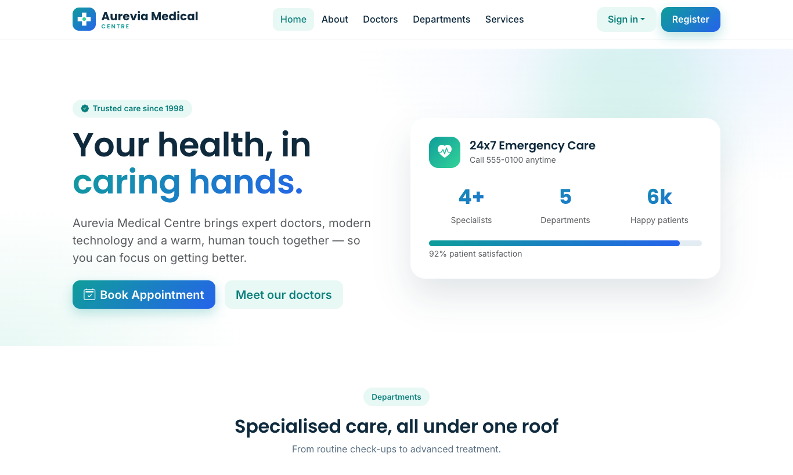
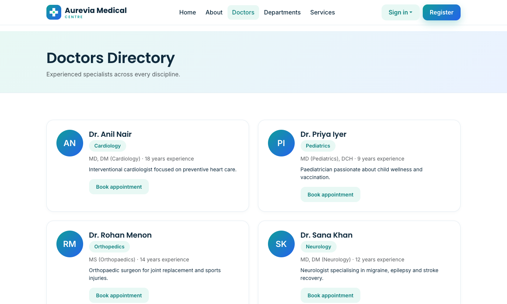
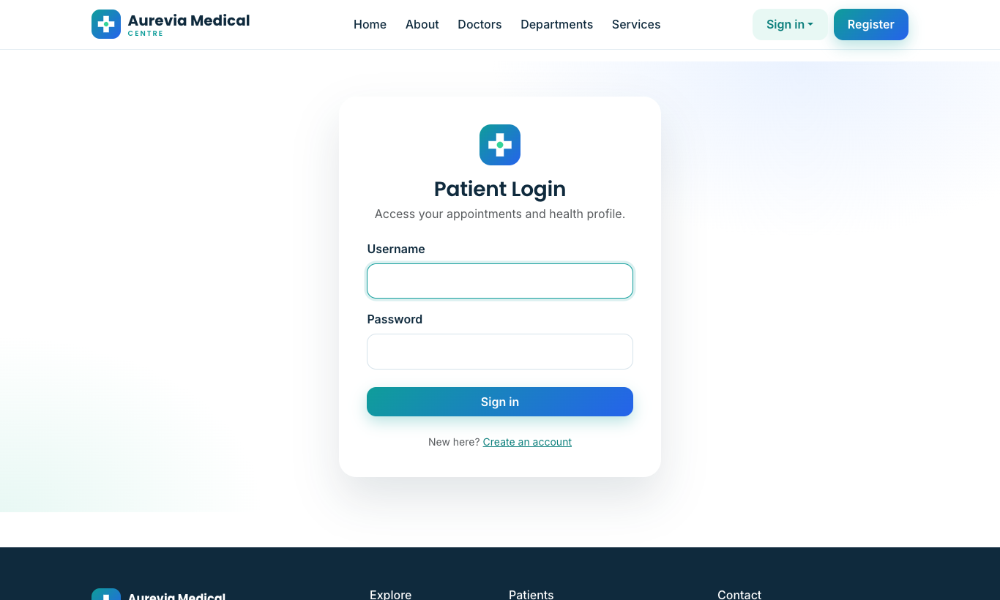
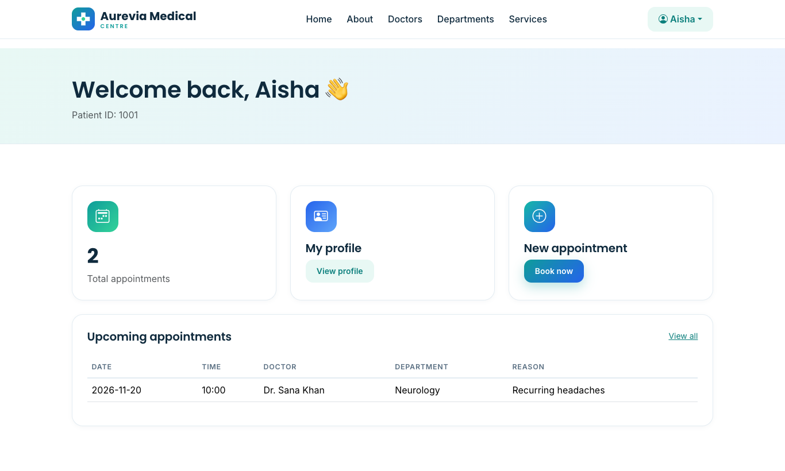
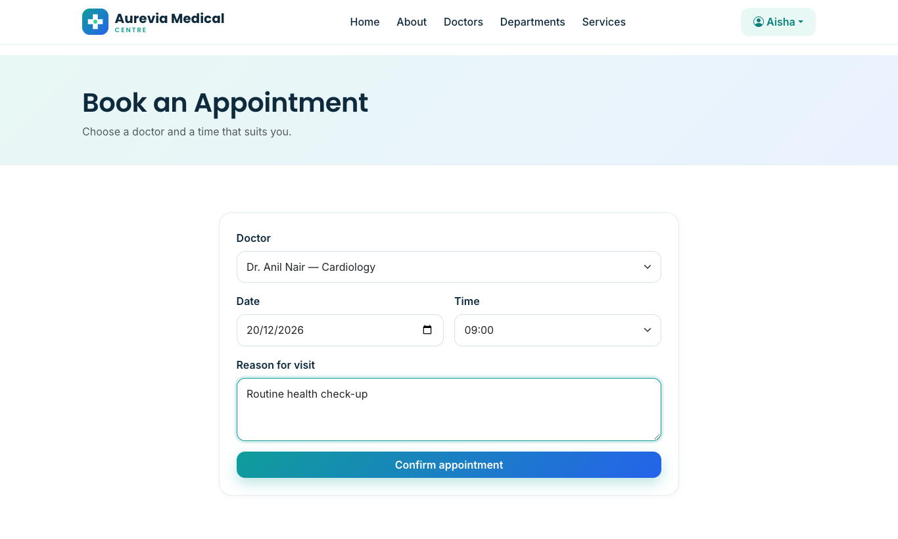
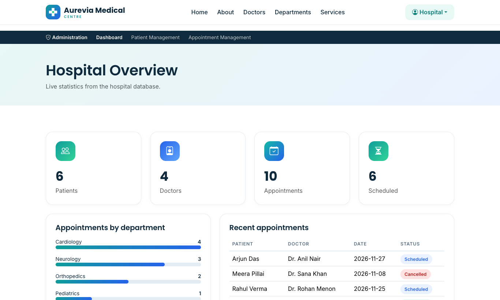
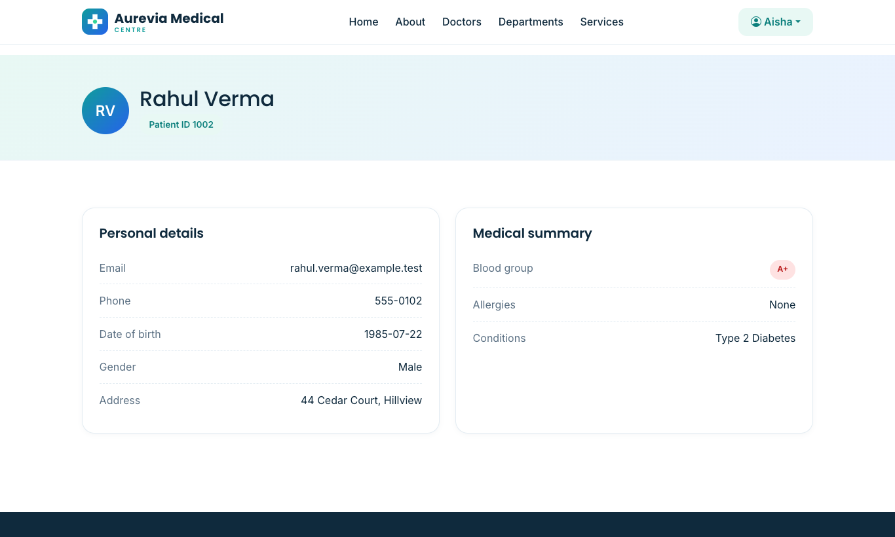
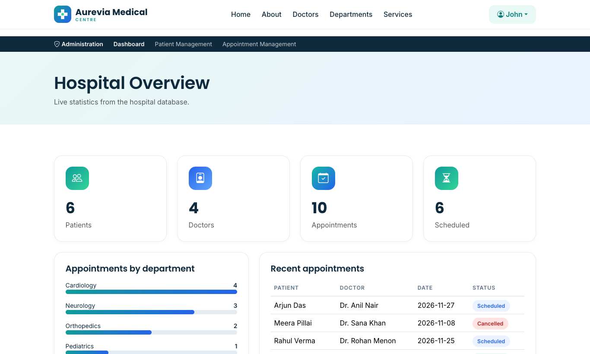

# 🏥 Aurevia Medical Centre — Intentionally Vulnerable Hospital App


A fully working hospital web application built as a **cybersecurity portfolio project**. It contains
**exactly two deliberate Broken Access Control vulnerabilities** — **IDOR** and **Vertical Privilege
Escalation** — so they can be found, exploited and fixed in a safe, local, synthetic-data lab.

> ⚠️ **Security disclaimer** — see [below](#️-security-disclaimer). Local use only.

## Overview
Aurevia Medical Centre looks and behaves like a real hospital site: public pages, patient registration,
three role-based portals (patient, doctor, admin), appointment booking and database-backed dashboards.
Everything except the two intentional flaws is built securely (hashed passwords, CSRF protection,
parameterised SQL, server-side role checks), so the vulnerabilities stand out clearly in a code review or pentest.

## Key features
| Area | Features |
|---|---|
| Public site | Home, About, Doctors directory, Departments, Services |
| Patients | Register, log in, dashboard, profile, book appointments, appointment history |
| Doctors | Log in, view assigned appointments |
| Admins | Log in, hospital statistics, patient management, appointment management |
| Security basics | Werkzeug password hashing, session handling, CSRF tokens, server-side validation, parameterised queries |
| Quality | 52 automated tests (pytest), modular code, config example, generated local secrets |

## Technologies
Python · Flask · SQLite · Flask sessions · Werkzeug · Jinja2 · Bootstrap 5 · Bootstrap Icons · pytest

## Architecture
```
AureviaMedicalProject/
├── AureviaMedicalCentre/              # the website
│   ├── app/
│   │   ├── __init__.py                # application factory
│   │   ├── config.py                  # settings (secrets generated locally, never hardcoded)
│   │   ├── db.py / seed.py            # SQLite schema + fictional seed data
│   │   ├── auth.py                    # login_required / role_required
│   │   ├── security.py                # CSRF protection
│   │   ├── validators.py              # form validation
│   │   └── routes/                    # public, accounts, patient, doctor, admin
│   ├── templates/  static/  database/ # UI, assets, runtime DB (git-ignored)
│   ├── tests/                         # pytest suite
│   ├── config.example.py  requirements*.txt  run.py
├── Cybersecurity_Assignment_Guide/    # analysis, walkthrough, remediation (NOT served by the app)
├── screenshots/
├── LICENSE  .gitignore  README.md
```
Request flow: browser → Flask route → `auth` decorators → SQLite (parameterised) → Jinja2 template.
The guide folder sits outside `app/`, `templates/` and `static/`, so no route can expose it.

## Screenshots
All captured from the running app with synthetic data.

| Homepage | Doctors directory |
|---|---|
|  |  |

| Patient login | Patient dashboard |
|---|---|
|  |  |

| Appointment booking | Admin dashboard |
|---|---|
|  |  |

**Vulnerability demonstrations**

| IDOR — signed in as *Aisha*, reading patient 1002 | Privilege escalation — patient *John* on the admin dashboard |
|---|---|
|  |  |

## Installation
Requires Python 3.12+ (macOS Apple Silicon and Kali Linux tested paths).
```bash
git clone <your-repo-url> AureviaMedicalProject
cd AureviaMedicalProject/AureviaMedicalCentre
python3 -m venv venv
source venv/bin/activate          # Windows: venv\Scripts\activate
pip install -r requirements.txt
python run.py                     # creates + seeds the database on first run
```
Open **http://127.0.0.1:5000**. The server **always binds to 127.0.0.1** (local machine only).
Stop with `Ctrl+C`. Reset the data: delete `database/hospital.db` and start again.

**Configuration** (all optional): copy `config.example.py` for reference. Settings come from environment variables:
| Variable | Purpose | Default |
|---|---|---|
| `AUREVIA_SECRET_KEY` | Session-signing key | random key generated into `database/secret.key` (git-ignored) |
| `AUREVIA_DATABASE` | SQLite file path | `database/hospital.db` |
| `PORT` | Listening port | `5000` |

## Local domain configuration
Use a friendly local name instead of the IP. Add a hosts entry (macOS and Kali):
```bash
echo "127.0.0.1 aureviamedicalcentre.local" | sudo tee -a /etc/hosts
```
Then browse **http://aureviamedicalcentre.local:5000**. To hide the port, serve on port 80 (needs `sudo`):
```bash
sudo env PORT=80 ./venv/bin/python run.py     # then: http://aureviamedicalcentre.local
```
macOS only, if the name doesn't resolve: `sudo dscacheutil -flushcache; sudo killall -HUP mDNSResponder`.

## Demo accounts (fictional, local lab only)
| Role | Username | Password | Notes |
|---|---|---|---|
| Patient | `aisha` | `Patient@123` | Patient ID **1001** |
| Patient | `rahul`, `meera`, `john`, `fatima`, `arjun` | `Patient@123` | IDs 1002–1006 |
| Doctor | `dr.nair`, `dr.khan`, `dr.iyer`, `dr.menon` | `Doctor@123` | |
| Admin | `admin` | `Admin@123` | |

## Educational vulnerability overview
| # | Vulnerability | Intentionally vulnerable route(s) | Root cause |
|---|---|---|---|
| 1 | **IDOR** (horizontal) | `GET /patient/profile/<patient_id>` | Record fetched by URL ID; no ownership check |
| 2 | **Vertical privilege escalation** | `GET /admin/dashboard`, `/admin/patients`, `/admin/appointments` | Login required, but no server-side admin-role check |

No other deliberate flaws exist (no SQL injection, no password bypass). Full details are in the guide below.

## Cybersecurity documentation
| Document | Contents |
|---|---|
| [Guide overview](Cybersecurity_Assignment_Guide/README.md) | Setup and credentials |
| [Vulnerability analysis](Cybersecurity_Assignment_Guide/vulnerability_analysis.md) | Concepts, exact routes, root cause, impact |
| [Exploitation walkthrough](Cybersecurity_Assignment_Guide/exploitation_walkthrough.md) | Step-by-step reproduction |
| [Remediation guide](Cybersecurity_Assignment_Guide/remediation_guide.md) | Corrected Flask code for both flaws |
| [Demonstration checklist](Cybersecurity_Assignment_Guide/mentor_demonstration_checklist.md) | Presentation order |

## Testing
```bash
cd AureviaMedicalProject/AureviaMedicalCentre
pip install -r requirements-dev.txt
pytest
```
The suite (52 tests) covers registration, authentication, logout, booking, secure behaviour of unrelated
routes, and `tests/test_intentional_vulnerabilities.py`, which explicitly documents the two vulnerable routes.
Those tests **pass because the flaws exist**; after applying the remediation guide they are expected to fail.

## ⚠️ Security disclaimer
This project intentionally contains two Broken Access Control vulnerabilities for authorized cybersecurity education and application security testing.

The vulnerabilities are IDOR and Vertical Privilege Escalation.

This application is designed exclusively for local testing using synthetic data. It must not be deployed to a public server or used against real hospital systems.

A separate remediation guide demonstrates how to correct both vulnerabilities.

## Future improvements
- Add a `FIXED=1` mode (or branch) that applies the remediation guide for side-by-side comparison
- Role-based admin blueprint with `before_request` enforcement
- Audit logging of denied access attempts
- Docker Compose setup bound to loopback
- Burp Suite / OWASP ZAP walkthrough with request captures
- Self-hosted Bootstrap assets for fully offline use

## License
[MIT](LICENSE)
